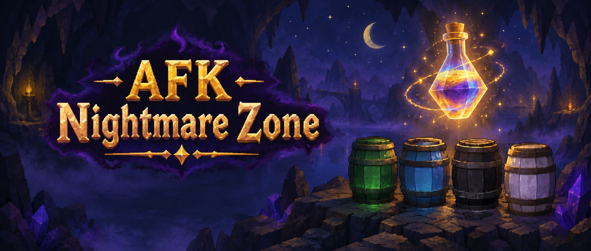

  

<h1 align="center">AFK Nightmare Zone</h1>

AFK Nightmare Zone is a RuneLite plugin that keeps long Nightmare Zone sessions safe and easy to track: it warns you
before your overload or absorption runs out, shows what is left in your potion barrels, counts your points, and stops
you from misclicking a locator orb or rock cake at the wrong moment.

## Features

### Alerts

- **Overload and absorption warnings**

  Get a notification shortly before your overload runs out (you choose how many seconds ahead), when it has expired,
  when your absorption points fall to a level you pick, and when they hit zero.

- **Out-of-potions and power-up alerts**

  Get told when your inventory runs out of overload or absorption doses, and (optionally) when a power surge,
  recurrent damage, zapper or ultimate force power-up spawns.

- **Live dream readout**

  An overlay inside the dream shows your overload timer, counting smoothly in tenths of a second, and your absorption
  points. Both turn red when they are low.

### Before you enter

- **Dose counts on the barrels**

  See how many overload, absorption, super ranging and super magic doses are stored without opening each barrel.

### Points

- **Points overlay**

  Shows your total points (including what you have earned so far in the dream). Inside a dream it also shows the
  points earned in that dream, points per hour and the dream time; these reset when you leave or die.

### Safety

- **Locator orb and rock cake guards**

  Optionally block a locator orb or dwarven rock cake click unless an overload is active and has finished hitting you.
  You can also block any click that would take you below a minimum HP (default 51) when no overload is active.

### Rewards

- **Reward goals**

  Tick the reward chest items or imbues you are saving for. The overlay shows how close your points are to the combined
  cost and notifies you when you can afford them.

## Links

- [Report a bug](https://github.com/Oveduumnakal/AFK-Nightmare-Zone-Plugin/issues/new?template=bug_report.yml)
- [Request a feature](https://github.com/Oveduumnakal/AFK-Nightmare-Zone-Plugin/issues/new?template=feature_request.yml)
- [Buy me a coffee](https://buymeacoffee.com/oveduumnakal)
