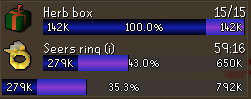
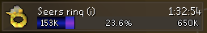
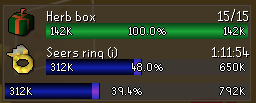
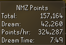
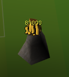
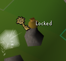
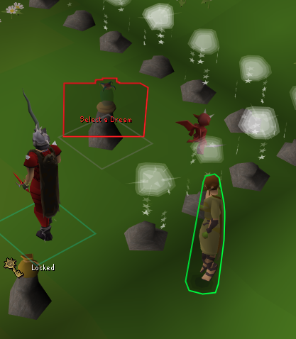
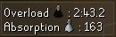
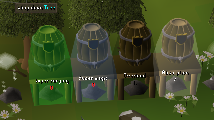
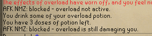

  

<h1 align="center">AFK Nightmare Zone</h1>

AFK Nightmare Zone is a RuneLite plugin for long Nightmare Zone sessions. Tick the rewards you are saving for and watch your points fill their bars, with an estimate of how long each one will take. It also tracks your points and dream time, tidies up the lobby, warns you before your overload or absorption runs out, and stops you from misclicking a locator orb or rock cake at the wrong moment.

## Features

### Rewards you are saving for

- **Tick it, track it**

  Pick any of the 30 reward chest items and imbues you want, and the plugin draws a bar for each one showing how many of its points you have. Set a quantity for the stackable rewards, such as 3 herb boxes or 100 overload doses. The settings are split into the shop and the ring imbues so the list stays easy to scan.

  

- **Progress and time to go**

  Each bar shows your points, the percent complete to one decimal place, and the cost. While you are in a dream, each reward also shows an estimate of how long it will take to afford at your current points-per-hour. A total bar underneath covers everything you have ticked.

  

- **Live while you dream**

  The purple segment grows as you earn points in the dream you are in, on top of the blue banked points, so you can see a reward come within reach before you leave. The bar turns green once your banked points alone cover the cost.

  

- **Told when you can afford it**

  Get a notification the moment your points, including those from the dream you are in, cover everything you have ticked. The imbue costs drop by half once you tell the plugin your Hard Combat Achievements reward is claimed.

### Points

- **Your points at a glance**

  The points panel shows your total points, including everything you have earned so far in the dream. Inside a dream it also shows the points earned in that dream, your points per hour, and how long the dream has been running. The dream figures start from zero when you enter and clear when you leave or die.

  

### In the lobby

- **See your coffer above Dominic's coffer**

  The coffer's coins are drawn right above Dominic's coffer. It reads Empty when there are no coins in it, and shows a locked notice with a key when it is still locked. The game's own coffer readout is hidden so you are not looking at two.

  

  

- **Never forget to pick a dream**

  While your potion vial is empty it is outlined in red with a "Select a Dream" label, and Dominic is outlined in green. Left-clicking Dominic runs "Dream" first, so one click takes you to the dream list.

  

- **Your Rumble party, listed**

  Once someone joins your Rumble party, a panel lists everyone in it. It stays hidden while you are on your own.

### During the dream

- **Live overload and absorption readout**

  An overlay inside the dream shows your overload timer, counting smoothly in tenths of a second, and your absorption points, each with the potion's icon. Both turn red when they are low. The game's own absorption readout is hidden so the overlay replaces it.

  

### Before you enter

- **Dose counts on the barrels**

  See how many overload, absorption, super ranging and super magic doses are stored without opening each barrel. Barrels can be tinted and the count turns a colour of your choice when it runs low.

  

### Safety

- **Locator orb and rock cake guards**

  Optionally block a locator orb or dwarven rock cake click unless an overload is active and has finished hitting you. You can also block any click that would take you below a minimum HP (default 51) when no overload is active. When a click is blocked, a chat message says why.

  

### Alerts

- **Overload and absorption warnings**

  Get a notification shortly before your overload runs out (you choose how many seconds ahead), when it has expired, when your absorption points fall to a level you pick, and when they hit zero. The low-absorption warning waits until your points are falling, so drinking a potion does not set it off.

- **Out-of-potions and power-up alerts**

  Get told when your inventory runs out of overload or absorption doses, and (optionally) when a power surge, recurrent damage, zapper or ultimate force power-up spawns.

- **AFK alerts**

  Get told when your HP is low with no overload active, when your ranging or magic boost fades, and when the dream ends.

### Where things go

- **Tidy by default, yours to move**

  The plugin's panels start stacked down the left edge of the screen, centred vertically, so they stay out of the way. Drag any of them wherever you like and the plugin leaves it there.

## Links

- [Report a bug](https://github.com/Oveduumnakal/AFK-Nightmare-Zone-Plugin/issues/new?template=bug_report.yml)
- [Request a feature](https://github.com/Oveduumnakal/AFK-Nightmare-Zone-Plugin/issues/new?template=feature_request.yml)
- [Buy me a coffee](https://buymeacoffee.com/oveduumnakal)
